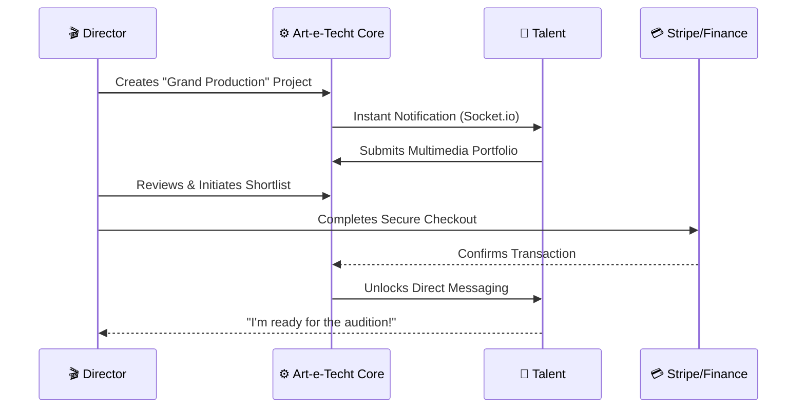

This <p align="center">
  
</p>

<h1 align="center">Art-e-Techt Atelier</h1>

<p align="center">
  <b>The Enterprise-Grade Ecosystem Bridging Visionary Directors & Exceptional Talent.</b>
</p>

<p align="center">
  <a href="https://nodejs.org/"></a>
  <a href="https://react.dev/"></a>
  <a href="https://www.mongodb.com/"></a>
  <a href="https://www.docker.com/"></a>
</p>

---

## 💎 The Vision

> [!IMPORTANT]
> **Art-e-Techt** is a creative talent marketplace connecting artists, directors, and production teams through discovery, portfolios, casting, and collaboration tools.

---

## 🚀 The Ecosystem Flow

Understand how **Art-e-Techt** connects creativity and opportunity.



---

## ⚡ Engineered for Excellence

### 🏗️ Scalable Architecture
- **Real-time Engine**: Powered by **Socket.io** for sub-100ms latency in messaging and alerts.
- **Media Optimization**: Seamless integration with **Cloudinary** for high-fidelity asset management.
- **Security First**: Implementation of **Helmet**, **CORS**, and **Rate Limiting** to ensure 99.9% resilience against common vulnerabilities.

### 💰 Business Readiness
- **Monetization Layer**: Production-ready **Stripe** integration for recurring subscriptions and project-based fees.
- **Multi-Lingual Reach**: Global ready with `i18next` support for diverse creative markets.
- **Admin Command Center**: Advanced RBAC (Role-Based Access Control) for system-wide governance.

---

## 🛠️ Technology Showcase

| Tech | Purpose | Innovation Level |
| :--- | :--- | :--- |
| **React 19** | Ultra-smooth UI/UX | 🚀 Cutting Edge |
| **Express 5.x** | High-concurrency API | 🛡️ Robust |
| **MongoDB 9.x** | Flexible Data Modeling | 📊 Scalable |
| **Vite** | Lightning-fast Build | ⚡ Optimized |
| **Zod** | Type-safe Validation | ✅ Accurate |

---

## 🚥 Quick Start & Deployment

### 🐳 The One-Command Experience
Forget complex configuration. Spin up the entire environment (Web, API, DB) in seconds:
```bash
docker-compose up -d --build
```

### 👨‍💻 Manual Spin-up
1. Copy `server/.env.example` to `server/.env` and configure the required backend credentials.
2. Start the API: `cd server && npm ci && npm run dev`
3. Copy `client/.env.example` to `client/.env`, then start the web app: `cd client && npm ci && npm run dev`

Never commit `.env` files or service-account credentials.

### Firebase Hosting Deployment

The React application deploys to the `art-e-techt-95db8` Hosting site in Firebase project `talentconnect-6e347`. The API and Socket.IO service remain on Render; Firebase Hosting only serves the built frontend.

1. Install the Firebase CLI and authenticate with an account that can administer the Firebase project: `npm install --global firebase-tools` and `firebase login`.
2. Set these GitHub Actions repository variables for production builds:
   `VITE_API_URL`, `VITE_SOCKET_URL`, `VITE_STRIPE_PUBLISHABLE_KEY`,
   `VITE_FIREBASE_API_KEY`, `VITE_FIREBASE_AUTH_DOMAIN`,
   `VITE_FIREBASE_PROJECT_ID`, `VITE_FIREBASE_STORAGE_BUCKET`,
   `VITE_FIREBASE_MESSAGING_SENDER_ID`, `VITE_FIREBASE_APP_ID`,
   `VITE_FIREBASE_MEASUREMENT_ID`, `VITE_LINKEDIN_CLIENT_ID`,
   `VITE_LINKEDIN_REDIRECT_URI`, and `VITE_SENTRY_DSN`.
   Set `VITE_LINKEDIN_REDIRECT_URI` to
   `https://art-e-techt-95db8.web.app/auth/linkedin/callback`.
3. Add the Firebase service-account JSON as the GitHub Actions secret `FIREBASE_SERVICE_ACCOUNT_PRODUCTION`.
4. In Google Cloud Console, set the OAuth consent-screen app name to `Art-e-Techt` and the support email to `learncode2025engineering@gmail.com`.
5. Build and deploy from the repository root:
   ```bash
   cd client
   npm ci
   npm run build
   cd ..
   firebase deploy --only hosting:art-e-techt-95db8 --project talentconnect-6e347
   ```
6. Verify the new site, authentication, API, Socket.IO, payments, and OAuth callback before retiring the old Hosting site. To retire it, use Firebase Console or `firebase hosting:sites:delete talentconnect-6e347 --project talentconnect-6e347` after confirming the new site is live.

The deployed Render service must allow `https://art-e-techt-95db8.web.app` in `FRONTEND_URL` / `ALLOWED_ORIGINS`; add the same origin to Firebase Auth authorized domains and the LinkedIn OAuth callback configuration.

---

## 🛡️ Stability & Performance
- **Compression**: Gzip/Brotli enabled for minimal payload delivery.
- **Morgan**: Detailed audit logs for every transaction.
- **TanStack Query**: Intelligent caching layer for zero-redundancy data fetching.

---

## 👥 Meet the Architects
**Lakshya Hidau** • **Vishal Jain** • **Shyamal Sheorey**

[](https://github.com/lakshya-hidau/Art-e-Techt)

---
<p align="center">
  <i>Art-e-Techt Atelier — where creative ideas become extraordinary creations.</i>
</p>
